# AIBlockList — Database Design, ERD & Migration Plan (Task C.3, C.4)

- **Database Engine:** PostgreSQL 16+
- **Required Extensions:** `pgcrypto` (UUIDs/hashing), `pg_trgm` (handle trigram search), `vector` (`pgvector` 384-dim local embeddings)
- **Migration Tool:** Alembic (managed via SQLAlchemy 2.x async metadata + explicit SQL trigger/grant migrations)

---

## 1. Three-Schema Security Isolation & Role Matrix

To enforce **Privacy by Architecture** and **Append-Only Audit Integrity** at the database engine layer, tables are partitioned across three PostgreSQL schemas:

| Schema | Contents | `aibl_public_ro` (Public Read API & Snapshot Builder) | `aibl_app_rw` (Core API & ARQ Workers) | `aibl_migrator` (Alembic CI/Deploy Only) |
|---|---|---|---|---|
| **`intel`** | Publicly distributable intelligence (`policy_versions`, `accounts`, `account_handle_history`, `evidence_items`, `external_sources`, `external_list_entries`, `coordinated_clusters`, `coordinated_cluster_members`) | `SELECT` only | `SELECT, INSERT, UPDATE` (no `DELETE` on `policy_versions`) | Full DDL |
| **`ops_private`** | Private operational & PII tables (`users`, `roles`, `permissions`, `user_roles`, `role_permissions`, `user_sessions`, `api_keys`, `reporters`, `reports`, `behavioral_signals`, `verification_jobs`, `moderation_decisions`, `appeal_verification_challenges`, `appeals`, `source_sync_runs`, `snapshot_versions`, `notification_preferences`, `notifications`, `security_events`, `rate_limit_events`, `platform_api_usage`, `data_deletion_requests`, `hash_salts`) | **ZERO ACCESS** | Scoped `SELECT, INSERT, UPDATE, DELETE` | Full DDL |
| **`audit`** | Immutable cryptographic trail (`audit_logs`, `merkle_checkpoints`) | `SELECT` on `merkle_checkpoints` only | `SELECT, INSERT` ONLY (`UPDATE, DELETE, TRUNCATE` revoked) | Full DDL (with immutable policy) |

---

## 2. Entity Relationship Diagram (ERD)

```mermaid
erDiagram
    policy_versions ||--o{ accounts : "governs"
    policy_versions ||--o{ moderation_decisions : "applied_in"
    policy_versions ||--o{ behavioral_signals : "evaluated_under"

    accounts ||--o{ account_handle_history : "tracks_renames"
    accounts ||--o{ evidence_items : "backed_by"
    accounts ||--o{ external_list_entries : "asserted_by"
    accounts ||--o{ reports : "reported_in"
    accounts ||--o{ verification_jobs : "verified_by"
    accounts ||--o{ behavioral_signals : "scored_with"
    accounts ||--o{ moderation_decisions : "adjudicated_by"
    accounts ||--o{ appeals : "contested_via"
    accounts ||--o{ appeal_verification_challenges : "verified_ownership"
    accounts ||--o{ coordinated_cluster_members : "linked_in"

    external_sources ||--o{ external_list_entries : "publishes"
    external_sources ||--o{ source_sync_runs : "synced_via"

    coordinated_clusters ||--o{ coordinated_cluster_members : "contains"

    users ||--o{ user_roles : "assigned"
    roles ||--o{ user_roles : "granted_to"
    roles ||--o{ role_permissions : "includes"
    permissions ||--o{ role_permissions : "bound_to"
    users ||--o{ user_sessions : "authenticates"
    users ||--o{ api_keys : "owns"
    users ||--o| reporters : "maps_to"
    users ||--o{ moderation_decisions : "reviews_as_primary_or_second"
    users ||--o{ appeals : "adjudicates_independently"
    users ||--o{ notification_preferences : "configures"
    users ||--o{ notifications : "receives"

    reporters ||--o{ reports : "submits"
    verification_jobs ||--o{ platform_api_usage : "incurs_cost"
    moderation_decisions ||--o{ appeals : "contested_decision"
```

---

## 3. Complete Table & Constraint Specification

### 3.1 Custom ENUM Types
- `platform_enum`: `'x'`, `'bluesky'`, `'mastodon'`, `'reddit'`, `'threads'`, `'telegram'`, `'discord'`, `'linkedin'`, `'instagram'`, `'facebook'`
- `classification_enum`: `'confirmed_automated_spam'`, `'repetitive_engagement_farming'`, `'coordinated_manipulation'`, `'suspicious_automation'`, `'under_review'`, `'cleared'`, `'delisted'`
- `verification_status_enum`: `'unverified'`, `'pending_human'`, `'verified'`, `'unverified_external'`
- `confidence_level_enum`: `'low'`, `'medium'`, `'high'`
- `identity_confidence_enum`: `'immutable_id'`, `'handle_only_unverified'`
- `appeal_status_enum`: `'none'`, `'under_review'`, `'temporarily_withheld'`, `'confirmed'`, `'appealed'`, `'cleared'`, `'delisted'`
- `report_status_enum`: `'queued'`, `'triaging'`, `'suspected_brigading'`, `'escalated'`, `'escalated_budget_paused'`, `'resolved'`, `'closed_duplicate'`, `'rejected_abuse'`

### 3.2 `intel` Schema (Public Intelligence — Zero Private PII)

| Table | Key Columns | Constraints & Indexes |
|---|---|---|
| **`intel.policy_versions`** | `id (UUID PK)`, `version_tag (VARCHAR 32 UNIQUE)`, `summary`, `document_url`, `signal_thresholds (JSONB)`, `is_active (BOOL)`, `effective_at`, `created_at` | Immutable once `is_active = TRUE` (trigger blocks `UPDATE/DELETE` on active policies). |
| **`intel.accounts`** | `id (UUID PK)`, `platform`, `platform_account_id (VARCHAR 128)`, `identity_confidence`, `username`, `normalized_username`, `is_handle_current (BOOL DEFAULT TRUE)`, `public_profile_url`, `classification (DEFAULT 'under_review')`, `verification_status (DEFAULT 'unverified')`, `confidence_level (DEFAULT 'low')`, `is_high_impact (BOOL DEFAULT FALSE)`, `has_source_conflict (BOOL DEFAULT FALSE)`, `appeal_status (DEFAULT 'none')`, `policy_version_id (FK)`, `public_rationale`, `cleared_cooldown_until (TIMESTAMPTZ)`, `last_reviewed_at`, `re_review_due_at`, `created_at`, `updated_at` | `UNIQUE (platform, platform_account_id) WHERE platform_account_id IS NOT NULL`; `UNIQUE (platform, normalized_username) WHERE is_handle_current = TRUE`; `GIN (normalized_username gin_trgm_ops)`; partial B-tree `(platform, classification) WHERE verification_status = 'verified'`; B-tree `(re_review_due_at) WHERE re_review_due_at IS NOT NULL`. |
| **`intel.account_handle_history`** | `id (UUID PK)`, `account_id (FK)`, `previous_username`, `new_username`, `observed_at`, `verified_via_api (BOOL)` | Preserves handle-rename trail to prevent innocent handle-squatting misattribution. |
| **`intel.evidence_items`** | `id (UUID PK)`, `account_id (FK CASCADE)`, `platform_post_id (VARCHAR 128)`, `public_post_url`, `signal_type (VARCHAR 64)`, `signal_metrics (JSONB)`, `content_hash_sha256 (CHAR 64)`, `embedding (VECTOR 384)`, `embedding_model (VARCHAR 64)`, `embedding_model_version (VARCHAR 32)`, `source_deleted_at (TIMESTAMPTZ)`, `collected_at` | `UNIQUE (account_id, platform_post_id)`; HNSW index `USING hnsw (embedding vector_cosine_ops)` (created in Phase 2); **zero raw full-text post storage**; tombstoned via `source_deleted_at`. |
| **`intel.external_sources`** | `id (UUID PK)`, `slug (VARCHAR 64 UNIQUE)`, `display_name`, `maintainer_handle`, `source_url`, `license_spdx`, `sync_enabled (BOOL DEFAULT FALSE)`, `sync_paused_reason`, `reliability_score (NUMERIC 4,3)`, `last_synced_at`, `created_at` | `sync_enabled` defaults `FALSE` until license & integration method approved. |
| **`intel.external_list_entries`** | `id (UUID PK)`, `source_id (FK CASCADE)`, `account_id (FK CASCADE)`, `source_list_version`, `source_classification`, `source_evidence_url`, `first_seen_at`, `last_seen_at`, `removed_upstream_at` | `UNIQUE (source_id, account_id)`; never mutates `intel.accounts.classification`. |
| **`intel.coordinated_clusters`** | `id (UUID PK)`, `platform`, `cluster_label`, `member_count (INT CHECK >= 3)`, `policy_version_id (FK)`, `summary_metrics (JSONB)`, `verified_by_human (BOOL DEFAULT FALSE)`, `detected_at` | Supports `SIG-04` (`coordinated_manipulation`, >= 3 linked accounts). |
| **`intel.coordinated_cluster_members`** | `cluster_id (FK)`, `account_id (FK)`, `joined_at` | `PRIMARY KEY (cluster_id, account_id)`. |

### 3.3 `ops_private` Schema (Strictly Restricted Operational & PII Data)

| Table | Key Columns | Security & Integrity Notes |
|---|---|---|
| **`ops_private.users`** | `id (UUID PK)`, `email (UNIQUE)`, `display_name`, `auth_provider`, `external_auth_id`, `mfa_enabled (BOOL)`, `mfa_method ('webauthn'\|'totp')`, `is_active`, `created_at`, `last_login_at` | Moderators/Admins require `mfa_enabled = TRUE` enforced in auth middleware + DB check for privileged roles. |
| **`ops_private.roles`**, **`permissions`**, **`user_roles`**, **`role_permissions`** | Standard RBAC tables (`report_reviewer`, `senior_moderator`, `appeal_reviewer`, `ts_admin`, `infra_admin`, `contributor`, `appellant`) | Strictly separated from GitHub code permissions; audited on every role change. |
| **`ops_private.user_sessions`** | `id (UUID PK)`, `user_id (FK)`, `session_token_hash (CHAR 64 UNIQUE)`, `session_context ('contributor'\|'appellant'\|'moderator'\|'admin')`, `mfa_verified_at`, `ip_subnet_hash`, `expires_at`, `revoked_at` | Short-lived moderator sessions (e.g., 4h sliding / 12h max); instant revocation support. |
| **`ops_private.api_keys`** | `id (UUID PK)`, `user_id (FK)`, `key_prefix (VARCHAR 16)`, `key_hash_sha256 (CHAR 64 UNIQUE)`, `tier ('community'\|'developer'\|'enterprise')`, `rate_limit_rpm (INT DEFAULT 600)`, `last_used_at`, `revoked_at`, `created_at` | Raw key (`aibl_live_...`) shown **once** at creation; only SHA-256 hash stored. |
| **`ops_private.hash_salts`** | `salt_date (DATE PK)`, `salt_secret_encrypted (BYTEA)`, `expires_at (TIMESTAMPTZ)` | Daily rotating salt purged after 30 days to enforce IP subnet hash TTL. |
| **`ops_private.reporters`** | `id (UUID PK)`, `user_id (UUID UNIQUE FK NULLABLE)`, `ip_subnet_hash (CHAR 64)`, `standing_score (NUMERIC 5,2 DEFAULT 1.00)`, `total_reports`, `upheld_reports`, `rejected_reports`, `is_suspended`, `created_at` | Never exposed in public API; internal weighting only. |
| **`ops_private.reports`** | `id (UUID PK)`, `account_id (FK)`, `reporter_id (FK)`, `reason_code`, `submitted_urls (JSONB)`, `canonical_dedup_key (CHAR 64)`, `explanation (VARCHAR 1000)`, `status (report_status_enum)`, `brigading_flag (BOOL DEFAULT FALSE)`, `status_token_hash (CHAR 64)`, `created_at` | `CHECK (char_length(explanation) <= 1000)`; index on `(canonical_dedup_key, created_at)` for 24h dedup. |
| **`ops_private.verification_jobs`** | `id (UUID PK)`, `account_id (FK)`, `trigger_source`, `status`, `attempts`, `error_code`, `started_at`, `completed_at`, `created_at` | Tracks async worker lifecycle & idempotency. |
| **`ops_private.behavioral_signals`** | `id (UUID PK)`, `account_id (FK)`, `verification_job_id (FK)`, `policy_version_id (FK)`, `signal_code ('SIG-01'..'SIG-05')`, `triggered (BOOL)`, `metrics (JSONB)`, `sample_size (INT)`, `window_hours (INT)`, `computed_at` | Reproducible deterministic signal output for Reviewer Packet. |
| **`ops_private.moderation_decisions`** | `id (UUID PK)`, `account_id (FK)`, `reviewer_id (FK users)`, `second_reviewer_id (FK users NULLABLE)`, `previous_classification`, `new_classification`, `policy_version_id (FK)`, `evidence_item_ids (UUID[])`, `internal_notes (TEXT)`, `public_rationale (TEXT)`, `created_at` | `CHECK (second_reviewer_id IS NULL OR second_reviewer_id <> reviewer_id)`; `internal_notes` strictly private. |
| **`ops_private.appeal_verification_challenges`** | `id (UUID PK)`, `account_id (FK)`, `method ('oauth'\|'bio_token')`, `token_hash_sha256 (CHAR 64)`, `expires_at`, `consumed_at`, `verified_account_id_snapshot`, `created_at` | Single-use, time-limited (e.g., 30 min), bound to `(platform, platform_account_id)`. |
| **`ops_private.appeals`** | `id (UUID PK)`, `account_id (FK)`, `contested_decision_id (FK moderation_decisions)`, `challenge_id (FK)`, `verification_method`, `verified_at`, `appellant_statement`, `supporting_links (JSONB)`, `status (appeal_status_enum DEFAULT 'appealed')`, `assigned_reviewer_id (FK users)`, `second_panelist_id (FK users NULLABLE)`, `resolution_notes`, `public_correction_note`, `triage_due_at`, `sla_due_at`, `submitted_at`, `resolved_at` | Unique partial index enforcing max 1 active appeal per account; DB trigger forbids original reviewer(s) from assignment. |
| **`ops_private.source_sync_runs`** | `id (UUID PK)`, `source_id (FK)`, `source_version`, `records_total`, `records_added`, `records_removed`, `change_ratio (NUMERIC 5,4)`, `anomaly_paused (BOOL)`, `status`, `error_summary`, `started_at`, `completed_at` | Records every federated sync + >10% anomaly circuit-breaker trips. |
| **`ops_private.snapshot_versions`** | `id (UUID PK)`, `platform`, `schema_version`, `dataset_version (UNIQUE per platform)`, `record_count`, `sha256_checksum (CHAR 64)`, `r2_object_key`, `policy_version_id (FK)`, `is_published (BOOL)`, `created_at` | Enables atomic manifest swaps and safe rollback. |
| **`ops_private.platform_api_usage`** | `id (BIGSERIAL PK)`, `platform`, `verification_job_id (FK NULLABLE)`, `request_type ('user_read'\|'post_read'\|'deletion_check')`, `units_consumed (INT)`, `assumed_unit_cost_usd (NUMERIC 10,5)`, `estimated_cost_usd (NUMERIC 10,5)`, `billing_period (CHAR 7)`, `utc_date (DATE)`, `created_at` | Powers hard daily/monthly spend caps and admin cost dashboards. |
| **`ops_private.notification_preferences`** & **`notifications`** | User/creator alert channels, delivery status, retry counts | Supports appeal updates & optional Phase 4–5 creator alerts. |
| **`ops_private.security_events`** & **`rate_limit_events`** | Anomalous moderator batch edits (>25/hr), auth failures, brigading trips, rate-limit blocks | Retained >= 1 year (aligning with India DPDP security log guidance). |
| **`ops_private.data_deletion_requests`** | `id (UUID PK)`, `regime ('gdpr'\|'dpdp'\|'platform_tombstone'\|'self_service')`, `target_entity_type`, `target_entity_id`, `status`, `requested_at`, `completed_at`, `legal_notes` | Tracks GDPR Art. 17/21, DPDP erasure/withdrawal, and X deletion compliance. |

### 3.4 `audit` Schema (Append-Only Cryptographic Trail)
- **`audit.audit_logs`**: `id (BIGSERIAL PK)`, `entity_type`, `entity_id (UUID)`, `action`, `actor_role`, `actor_pseudonym (VARCHAR 64)`, `payload_diff (JSONB)`, `prev_hash (CHAR 64)`, `record_hash (CHAR 64 NOT NULL)`, `created_at (TIMESTAMPTZ DEFAULT NOW())`.
- **`audit.merkle_checkpoints`**: `id (BIGSERIAL PK)`, `start_audit_id`, `end_audit_id`, `merkle_root_sha256 (CHAR 64)`, `published_at`.

---

## 4. Mandatory Database-Level Triggers & Invariants

1. **`trg_audit_logs_hash_chain` (`BEFORE INSERT` on `audit.audit_logs`)**:
   - Acquires `pg_advisory_xact_lock(hashtext('audit_logs_chain'))`.
   - Reads latest `record_hash` (or `'0' * 64` for genesis row).
   - Computes `record_hash = encode(digest(prev_hash || '|' || entity_type || '|' || entity_id || '|' || action || '|' || actor_role || '|' || payload_diff::text || '|' || to_char(created_at AT TIME ZONE 'UTC', 'YYYY-MM-DD"T"HH24:MI:SS.US"Z"'), 'sha256'), 'hex')`.
2. **`trg_accounts_publication_gate` (`BEFORE INSERT OR UPDATE` on `intel.accounts`)**:
   - Whenever `NEW.classification IN ('confirmed_automated_spam', 'repetitive_engagement_farming', 'coordinated_manipulation')` and `NEW.verification_status = 'verified'`:
     - Rejects if `NEW.policy_version_id IS NULL` or `NEW.public_rationale IS NULL` or `NEW.re_review_due_at IS NULL`.
     - Rejects if `COUNT(*)` of `intel.evidence_items` where `account_id = NEW.id AND source_deleted_at IS NULL` is `< 2`.
     - Rejects if no matching `ops_private.moderation_decisions` row exists for `(NEW.id, NEW.classification)` in the current transaction/history.
     - If `NEW.is_high_impact = TRUE`, rejects if that decision's `second_reviewer_id IS NULL` or equals `reviewer_id`.
3. **`trg_appeals_independent_reviewer` (`BEFORE INSERT OR UPDATE` on `ops_private.appeals`)**:
   - Whenever `NEW.assigned_reviewer_id IS NOT NULL` (or `NEW.second_panelist_id IS NOT NULL`):
     - Looks up `reviewer_id` and `second_reviewer_id` from `ops_private.moderation_decisions` where `id = NEW.contested_decision_id`.
     - Raises `EXCEPTION 'Independent appeal reviewer violated'` if the assigned appeal reviewer matches *either* original reviewer.
4. **`trg_policy_versions_immutable` (`BEFORE UPDATE OR DELETE` on `intel.policy_versions`)**:
   - Blocks `DELETE` unconditionally and blocks `UPDATE` on `version_tag`, `summary`, `document_url`, `signal_thresholds`, `effective_at` once `is_active = TRUE`.

---

## 5. Phased Alembic Database Migration Plan (Task C.4)

Migrations are strictly additive in production, tested automatically in CI against a fresh PostgreSQL 16 container (`upgrade head -> downgrade -1 -> upgrade head`), and gated by **2 Core Maintainer approvals** via `.github/CODEOWNERS`.

| Migration Batch | Phase | Scope | Rollback & Verification Gate |
|---|---|---|---|
| **M001–M003** | Phase 1 | Create extensions (`pgcrypto`, `pg_trgm`, `vector`), schemas (`intel`, `ops_private`, `audit`), roles (`aibl_public_ro`, `aibl_app_rw`), enums, `policy_versions`, `accounts`, `account_handle_history`, `evidence_items`, `audit_logs` + hash-chain trigger, `merkle_checkpoints` | Verify `aibl_public_ro` fails `SELECT` on `ops_private`; verify `aibl_app_rw` fails `UPDATE/DELETE` on `audit.audit_logs`; verify seed migration loads Policy v1.0.0 cleanly. |
| **M004–M007** | Phase 2 | Auth & RBAC (`users`, `roles`, `permissions`, `user_sessions`), anti-abuse (`hash_salts`, `reporters`, `reports`), verification (`verification_jobs`, `behavioral_signals`, `platform_api_usage`, `coordinated_clusters*`, HNSW index), governance (`moderation_decisions`, `appeal_verification_challenges`, `appeals`, `data_deletion_requests`, `security_events`), publication-gate & independent-appeal triggers | Automated SQL invariant tests: prove 0/1-evidence publish fails, single-reviewer high-impact publish fails, original-reviewer appeal assignment fails. |
| **M008–M010** | Phase 3 | Developer ecosystem (`api_keys`, `rate_limit_events`, `snapshot_versions`) and federation (`external_sources`, `external_list_entries`, `source_sync_runs`) | Verify `external_list_entries` cannot mutate `intel.accounts.classification`; benchmark `pg_trgm` vs. Meilisearch threshold. |
| **M011** | Phase 4–5 | Notifications (`notification_preferences`, `notifications`) and Phase 5 platform-specific indexes (ATProto DID lookups, Mastodon domain partitioning if needed) | Zero-downtime `CREATE INDEX CONCURRENTLY` policy for all post-launch indexes. |

### Backup & Restore Verification
- Continuous encrypted WAL archiving + daily base snapshots to offsite S3-compatible storage.
- Automated monthly staging restore test verifying: (1) schema integrity, (2) full `audit.audit_logs` hash-chain continuity, and (3) `RTO <= 4 hours`.
