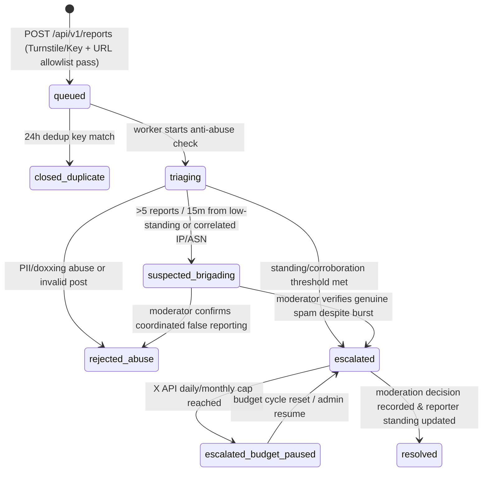
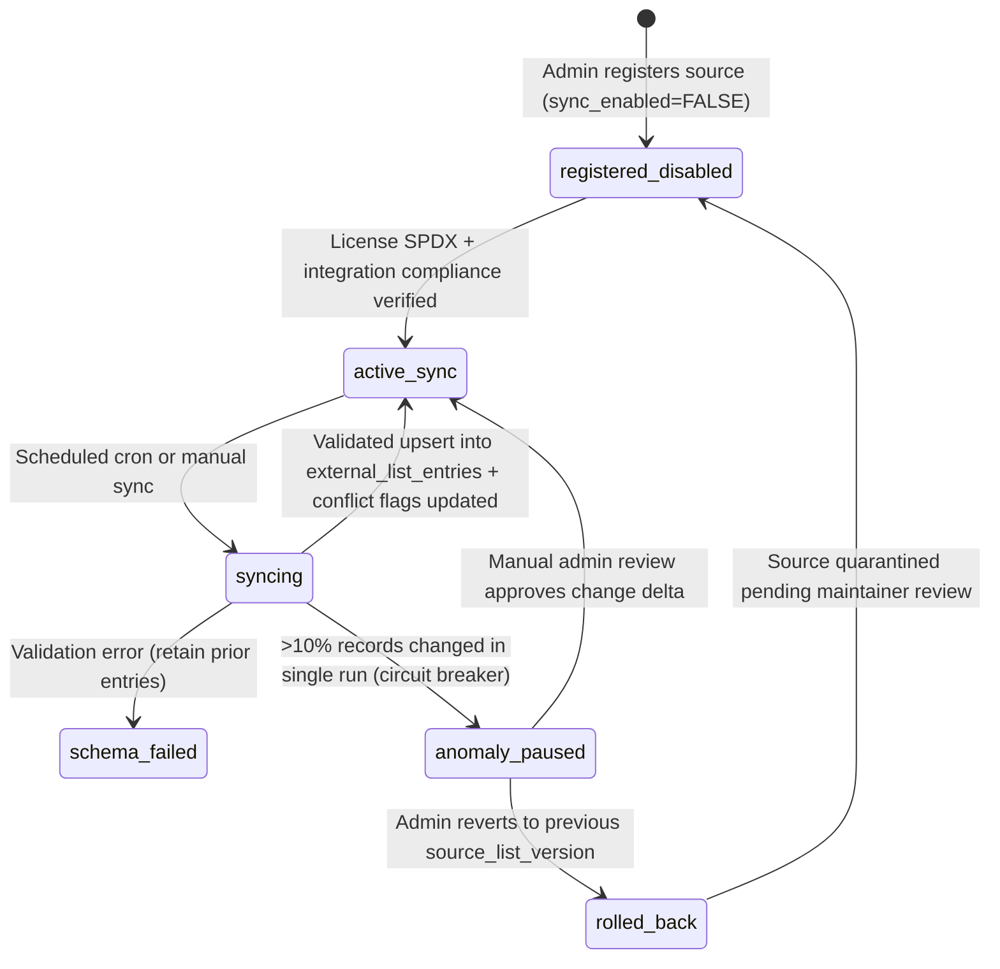

# AIBlockList — Domain State Machines & Event Catalog (Task C.6, C.7)

- **Enforcement:** All transitions are validated by a centralized Python `StateTransitionValidator` (`apps/api/app/core/state_machine.py`) AND reinforced by PostgreSQL triggers. Direct ORM column mutations bypassing domain services are prohibited.

---

## 1. Domain State Machines (Task C.6)

### 1.1 Account Lifecycle & 7-State Classification Machine

```mermaid
stateDiagram-v2
    [*] --> unreported
    unreported --> reported: valid community report accepted
    reported --> queued: dedup + schema pass
    queued --> triaging: worker claims report
    triaging --> rejected_abuse: invalid/abusive report
    triaging --> under_review: brigading quarantine OR standing/corroboration met
    under_review --> evidence_collection: budget & standing threshold met
    evidence_collection --> under_review: reviewer packet ready (human queue)

    under_review --> cleared: Human Reviewer (legitimate human / AI-assisted)
    under_review --> suspicious_automation: Human Reviewer (warning threshold; needs corroboration)
    under_review --> confirmed_automated_spam: Human Reviewer (+2nd if high-impact) + >=2 evidence
    under_review --> repetitive_engagement_farming: Human Reviewer (+2nd if high-impact) + >=2 evidence
    under_review --> coordinated_manipulation: Human Reviewer (+2nd if high-impact) + >=3 linked accounts

    suspicious_automation --> confirmed_automated_spam: Corroborated Human Review
    suspicious_automation --> cleared: Human Review

    confirmed_automated_spam --> under_review: 180d expiry OR evidence tombstoned <2
    repetitive_engagement_farming --> under_review: 180d expiry OR evidence tombstoned <2
    coordinated_manipulation --> under_review: 180d expiry OR evidence tombstoned <2

    confirmed_automated_spam --> appealed: Verified Owner Appeal
    repetitive_engagement_farming --> appealed: Verified Owner Appeal
    coordinated_manipulation --> appealed: Verified Owner Appeal
    suspicious_automation --> appealed: Verified Owner Appeal

    appealed --> temporarily_withheld: 48h triage spots clear identity/evidence error
    appealed --> confirmed_automated_spam: Independent 2nd Reviewer upholds
    appealed --> cleared: Independent 2nd Reviewer overturns (false positive)
    appealed --> delisted: Independent 2nd Reviewer approves 30d remediation / removal
    temporarily_withheld --> cleared: Independent 2nd Reviewer confirms error
    temporarily_withheld --> delisted: Independent 2nd Reviewer delists
    temporarily_withheld --> confirmed_automated_spam: Independent 2nd Reviewer upholds after re-check
```

#### Hard Classification Invariants
- **Public Hiding Boundary:** `under_review`, `temporarily_withheld`, `cleared`, `delisted`, and `unverified_external` MUST NEVER be merged into default confirmed spam lists.
- **Anti-Harassment Cooldown on `cleared`:** Once `cleared`, repeat reports for the same account within the cooldown window (default 30 days) require significantly higher corroboration and cannot auto-trigger paid X API calls unless new post URLs post-dating `last_reviewed_at` are supplied.
- **No Unreviewed Public Promotion:** Transitioning to `confirmed_automated_spam`, `repetitive_engagement_farming`, or `coordinated_manipulation` is **strictly blocked** without: (1) active `policy_version_id`, (2) >= 2 non-tombstoned evidence items, (3) human `moderation_decisions` row, (4) second distinct reviewer if `is_high_impact = TRUE`, and (5) atomic `audit.audit_logs` write.

---

### 1.2 Community Report & Brigading State Machine

---

### 1.3 Appeal & Ownership Verification Lifecycle

```mermaid
stateDiagram-v2
    [*] --> challenge_issued: POST /appeals/verify/init (OAuth or CSPRNG bio token)
    challenge_issued --> challenge_expired: TTL (30m) elapsed
    challenge_issued --> ownership_verified: OAuth callback or live bio token confirmed (single-use consumed)
    ownership_verified --> appealed: POST /appeals (acknowledged immediately; max 1/14d)
    appealed --> triage_48h: Procedural check (identity + evidence validity)
    triage_48h --> temporarily_withheld: Clear identity/evidence error (urgent snapshot rebuild)
    triage_48h --> independent_review: Assigned to reviewer != original reviewer(s)
    temporarily_withheld --> independent_review: Assigned to independent reviewer
    independent_review --> confirmed: Behavior violated active policy (upheld)
    independent_review --> cleared: False positive (public correction + source accuracy penalty)
    independent_review --> delisted: 30d clean remediation or expired evidence (public correction)
```

---

### 1.4 External Source Synchronization State Machine

---

## 2. Asynchronous Event & Background Job Catalog (Task C.7)

All asynchronous processing runs on **Valkey + ARQ** in two dedicated worker pools (`worker-io` for network/DB/R2 tasks; `worker-ml` for CPU ONNX embeddings & clustering) to isolate compute-heavy embedding workloads from latency-sensitive intake and urgent delisting jobs.

| Event / Job Name | Queue Pool | Trigger | Idempotency Key | Retries & DLQ | Guardrails & SLA |
|---|---|---|---|---|---|
| `report.intake.process` | `worker-io` | `POST /api/v1/reports` | `report:{report_id}` | 3x exp backoff -> `dlq:reports` | Runs PII redaction, 24h dedup, standing calc, and >5/15m brigading circuit breaker. Target <2s ack + <30s triage. |
| `verification.x.fetch_evidence` | `worker-io` | `report.escalated` | `x_fetch:{account_id}:{utc_date}` | 3x (respect `Retry-After`) -> `dlq:x_api` | **Hard budget guard:** checks `platform_api_usage` cap before every call; enforces 1 user + max 30 replies; respects 24h UTC dedup; pauses cleanly at 100% cap. |
| `verification.signals.compute` | `worker-ml` | `evidence.fetched` | `signals:{verification_job_id}` | 2x -> `dlq:signals` | Computes `SIG-01..05` against active `policy_versions`, generates ONNX 384d embeddings, runs `pgvector` cluster lookup, builds Reviewer Packet. |
| `verification.llm.advisory_summary` | `worker-io` | Manual moderator click or escalated packet (if enabled) | `llm_adv:{packet_id}` | 1x (best-effort; never blocks review) | Strictly optional; randomized delimiter sandbox; zero write permissions; labeled advisory-only. |
| `moderation.decision.committed` | `worker-io` | Human decision / cosign TX | `decision:{decision_id}` | 5x -> `dlq:post_decision` | Updates reporter standing scores (`upheld`/`rejected`), dispatches optional notifications, triggers Cloudflare API cache purge for account URL. |
| `appeal.urgent_delist_publish` | `worker-io` | Transition to `temporarily_withheld`, `cleared`, or `delisted` | `urgent_delist:{account_id}:{ts}` | 5x -> high-priority alert | **Priority queue:** purges CDN account cache immediately + rebuilds R2 delta/snapshot within `<2 minutes`. |
| `appeal.sla.monitor` | `worker-io` | Cron (hourly) | `appeal_sla:{hour}` | 2x | Alerts Trust & Safety team when any appeal approaches 48h triage or 7-business-day resolution SLA. |
| `snapshot.platform.build` | `worker-io` | Cron (hourly) | `snapshot:{platform}:{hour}` | 3x -> alert (retains prior valid version) | Builds gzipped snapshot + delta, validates schema & SHA-256, atomic R2 upload + manifest swap. |
| `federation.source.sync` | `worker-io` | Cron (per-source schedule) / manual | `sync:{source_id}:{run_id}` | 2x -> alert | Runs schema validation + >10% change circuit breaker; writes `external_list_entries` tagged `unverified_external`; recalculates `has_source_conflict`. |
| `accounts.rereview.schedule_180d` | `worker-io` | Cron (daily 02:00 UTC) | `rereview:{utc_date}` | 3x | Queries `re_review_due_at <= NOW()`, transitions stale confirmed listings to `under_review`, writes audit log, queues human re-audit. |
| `evidence.tombstone.audit` | `worker-io` | Cron (weekly, budgeted) + deletion webhook/request | `tombstone:{batch_id}` | 3x | Checks cited X post IDs for deletion/privation; sets `source_deleted_at`; if active evidence drops `< 2`, transitions account to `under_review`. |
| `privacy.deletion.execute` | `worker-io` | `ops_private.data_deletion_requests` | `del_req:{request_id}` | 3x -> admin alert | Executes GDPR Art. 17/21, DPDP consent withdrawal, self-service account deletion, and 30-day `hash_salts` purge. |
| `audit.chain.verify_and_checkpoint` | `worker-io` | Cron (daily 03:00 UTC) | `audit_chk:{utc_date}` | 2x -> **SEV-1 Pager** | Walks `audit.audit_logs` verifying every `prev_hash -> record_hash` link; publishes daily Merkle root to `audit.merkle_checkpoints`. |
| `transparency.aggregates.refresh` | `worker-io` | Cron (every 15m) | `trans_agg:{slot}` | 2x | Materializes non-PII stats (category counts, appeal overturn rates, per-source reliability scores) into Valkey cache for `/api/v1/statistics`. |
