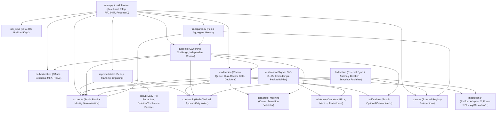
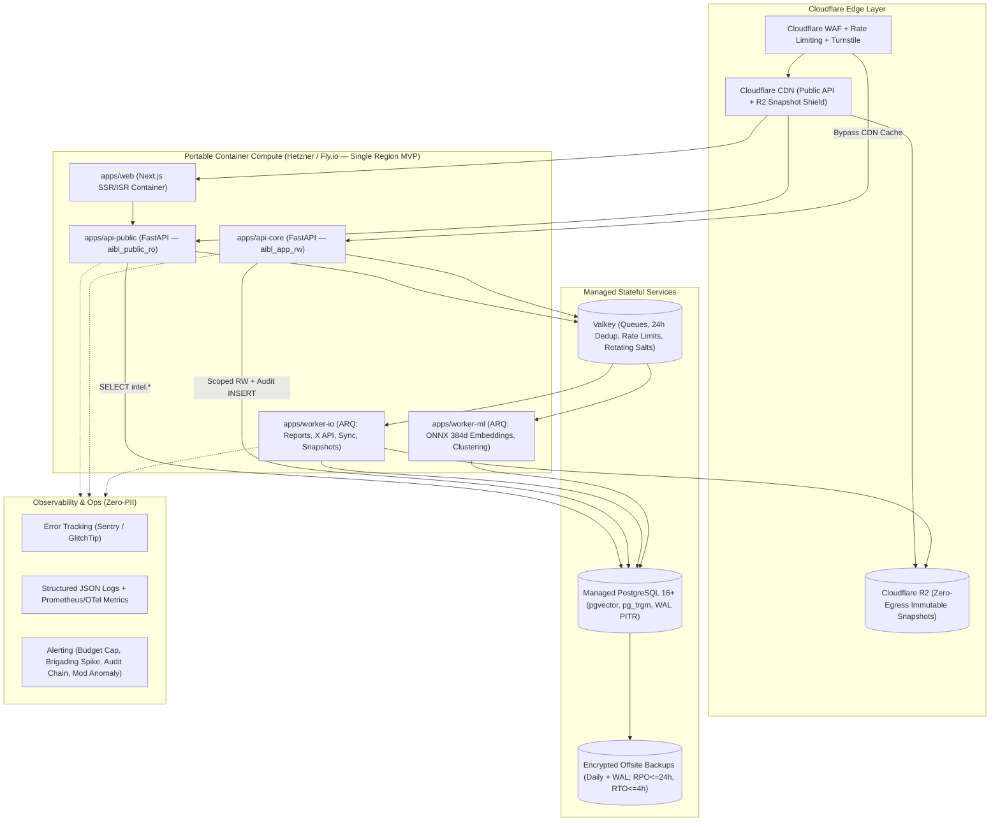

# AIBlockList — Final System & Deployment Architecture (Task C.1, C.2, C.9)

- **Version:** 1.0
- **Architecture Style:** Modular Monolith + Isolated Async Workers + Edge CDN Snapshot Distribution
- **Scope:** System, backend, worker, extension data layer, platform adapters, and deployment topology (UI/UX visual design explicitly excluded).

---

## 1. Six-Layer System Architecture & Trust Boundaries

The architecture enforces **four strict trust zones** so untrusted public input and external lists can never directly mutate verified public intelligence or leak private operational PII.

```mermaid
flowchart LR
    subgraph Z1["Zone 1: Untrusted Ingestion"]
        WEB_R["Web Report & Appeal Forms"]
        API_R["POST /api/v1/reports & /appeals"]
        EXT_S["External Blocklist Feeds"]
    end

    subgraph Z2["Zone 2: Anti-Abuse & Async Verification"]
        WAF["Cloudflare WAF + Turnstile"]
        ABUSE["Anti-Abuse, Standing & Brigading Gate"]
        VALKEY["Valkey (Queues, Rate Limits, 24h Dedup)"]
        WORKER["ARQ Workers (X API Client + Budget Cap)"]
        SIG["Deterministic Signal Engine (SIG-01..05) + ONNX 384d Embeddings"]
        LLM["Optional Sandboxed LLM Assist (Zero Write Perms)"]
    end

    subgraph Z3["Zone 3: Human Governance & System of Record"]
        MOD_Q["Moderator Review Queue (MFA + RBAC)"]
        DUAL["High-Impact Dual-Reviewer Gate"]
        APP_Q["Independent Appeals Panel (!= Original Reviewers)"]
        PG_PRIV[("PostgreSQL: ops_private schema")]
        PG_PUB[("PostgreSQL: intel schema")]
        PG_AUD[("PostgreSQL: audit schema (Append-Only Hash Chain)")]
    end

    subgraph Z4["Zone 4: Public Edge & Consumers"]
        API_PUB["FastAPI Public Read API (aibl_public_ro role)"]
        R2["Cloudflare R2 (Gzipped Snapshots + Deltas + Manifests)"]
        CDN["Cloudflare CDN (ETag + SWR)"]
        WEB_PUB["Next.js Public Search & Transparency Portal"]
        EXT_MV3["Chrome & Firefox MV3 Extension (Local-First 6h Sync)"]
        DEVS["3rd-Party Apps & SDKs"]
    end

    WEB_R --> WAF
    API_R --> WAF
    WAF --> ABUSE
    EXT_S --> VALKEY
    ABUSE --> PG_PRIV
    ABUSE --> VALKEY
    VALKEY --> WORKER
    WORKER --> SIG
    SIG -.->|"Untrusted Input (Isolated)"| LLM
    SIG -->|"Draft Reviewer Packet Only"| MOD_Q
    LLM -.->|"Advisory Note Only"| MOD_Q
    MOD_Q --> DUAL
    DUAL -->|"Atomic TX + Publication Gate"| PG_PUB
    DUAL --> PG_AUD
    APP_Q -->|"Independent Reversal / Withhold"| PG_PUB
    APP_Q --> PG_AUD
    PG_PUB -->|"Read-Only Role"| API_PUB
    PG_PUB -->|"Hourly + Urgent Delist Build"| R2
    API_PUB --> CDN
    R2 --> CDN
    CDN --> WEB_PUB
    CDN --> EXT_MV3
    CDN --> DEVS
```



### Layer Responsibilities & Technology Matrix
| Layer | Responsibilities | Technology | Trust Role |
|---|---|---|---|
| **Layer A: Public Web App** | SSR/ISR public account lookup, evidence viewer, transparency portal, auth entry, report/appeal form shells | Next.js (App Router), React, TypeScript | Public / Authenticated client; consumes API via typed client |
| **Layer B: Backend API** | Auth/RBAC/MFA, report intake, account lookup, moderation workflows, appeals, source registry, API keys, policy enforcement | Python 3.12+, FastAPI, Pydantic v2, SQLAlchemy 2 (async), Alembic | Enforces service-layer RBAC & domain state machines |
| **Layer C: Behavioral Intelligence** | URL canonicalization, `SIG-01`–`SIG-05` metrics, ONNX local 384-dim embeddings, `pgvector` clustering, reviewer packet builder | Python, ONNX Runtime (`fastembed`), `pgvector`, deterministic evaluators | Produces **draft packets only**; zero public write authority |
| **Layer D: Async Processing** | Report triage, budgeted platform API reads, embedding jobs, external source syncs, atomic R2 snapshots, deletion/tombstones, 180d re-reviews | Valkey (BSD-3) + ARQ workers | Separate container process from same codebase |
| **Layer E: Data & Storage** | System of record (`intel`, `ops_private`, `audit` schemas), cache/rate limits, immutable snapshot object storage | PostgreSQL 16+ (`pgvector`, `pg_trgm`), Valkey, Cloudflare R2 (prod) / MinIO (local) | Enforces DB-level constraints, triggers, and role isolation |
| **Layer F: Distribution & Extensions** | Edge caching, hourly + urgent delist gzipped snapshots & deltas, versioned REST API, local-first browser filtering | Cloudflare WAF/CDN/R2, Chrome & Firefox MV3 extensions | High-throughput read offloading; zero browsing telemetry |

---

## 2. Service & Module Dependency Diagram

Dependencies inside `apps/api/app/` must remain **strictly acyclic** and respect the `intel` vs. `ops_private` boundary.



### Mandatory Boundary Rules
1. `accounts`, `evidence`, `sources`, and `transparency` **public read paths** must NEVER import repositories from `reports`, `moderation`, `appeals`, or `authentication` private tables.
2. No module may mutate `intel.accounts.classification` directly; every mutation passes through `core/state_machine` + `moderation` or `appeals` inside a single DB transaction that also writes to `core/audit`.
3. `integrations/*` is strictly isolated behind `PlatformAdapter`; domain services never parse raw X/Bluesky JSON directly.

---

## 3. Platform Adapter Interface Contract

Every platform integration under `apps/api/app/integrations/<platform>/` must implement the following strict abstract base class and pass a dedicated **Platform Compliance Gate** before activation:

```python
class PlatformAdapter(Protocol):
    platform: PlatformEnum

    def capabilities(self) -> PlatformCapabilities:
        """Explicitly declares supported/unsupported ops (e.g., oauth_appeal, immutable_id, evidence_fetch)."""

    def validate_account_url(self, url: str) -> CanonicalAccountRef:
        """Strict allowlist parser; rejects non-canonical, private, or SSRF-risk URLs."""

    def validate_evidence_url(self, url: str) -> CanonicalEvidenceRef:
        """Validates exact public post/reply URL patterns; never performs HTTP fetch."""

    def normalize_account_identifier(self, raw_value: str) -> NormalizedIdentifier:
        """Normalizes handle casing/domain and distinguishes immutable ID vs mutable handle."""

    async def resolve_account_identity(self, ref: CanonicalAccountRef) -> AccountIdentityResult:
        """Resolves immutable platform_account_id & current handle via official API (budget-checked)."""

    async def fetch_permitted_evidence(
        self, account_ref: CanonicalAccountRef, post_ids: list[str], sample_limit: int = 30
    ) -> list[RawPermittedPost]:
        """Bounded official API fetch respecting 24h UTC dedup, rate limits, and spend caps."""

    def normalize_evidence(self, raw_posts: list[RawPermittedPost]) -> list[NormalizedEvidenceInput]:
        """Strips raw storage persistence; extracts canonical URLs, timestamps, SHA-256 hashes, metrics."""

    async def check_rate_limits(self) -> RateLimitBudgetStatus:
        """Reports remaining API quota and spend-cap headroom."""

    async def handle_deleted_content(self, post_ids: list[str]) -> list[DeletionCheckResult]:
        """Verifies whether cited posts were deleted/privated for mandatory tombstone compliance."""
```

### Rollout & Compliance Matrix
| Phase | Platform | Integration Mode | Compliance Status |
|---|---|---|---|
| **Phase 1–4** | **X** | Targeted official v2 API (`1 user + 30 replies`), 24h UTC dedup, \$100/mo cap, Public Utility App application | Primary MVP target |
| **Phase 5.1** | **Bluesky** | Open ATProto APIs + native Ozone (`tools.ozone`) labeler; `did:plc`/`did:web` IDs | Top expansion priority |
| **Phase 5.2** | **Mastodon** | ActivityPub / Mastodon REST API; FediCheck/admin-compatible blocklist exports | Strong expansion target |
| **Phase 5.3** | **Telegram** | Opt-in group moderation Bot API (CAS model); immutable numeric User IDs; zero global scraping | Opt-in bot only |
| **Phase 5.4** | **Reddit / Threads / Discord** | Gated on Reddit Commercial Data API audit, Meta App Review (Threads Reply Moderation), Discord Privileged Intents | Blocked until platform approval |
| **Excluded** | **LinkedIn / Facebook / Instagram** | Prohibited from global account directory/scraping (LinkedIn §8.2 & Profile API ban; Meta closed personal profiles) | Permanently out of scope for global DB |

---

## 4. Browser Extension Local-First Architecture (Phase 4)

- **Packages:** Single TypeScript codebase in `apps/extension/` compiling to **Chrome MV3** and **Firefox MV3** manifests.
- **Zero Feed Exfiltration Invariant:** Content scripts NEVER call AIBlockList servers when rendering social timelines or profiles.
- **Sync Protocol (Background Service Worker):**
  1. `chrome.alarms` wakes every **6 hours** (plus manual "Check now" button).
  2. Sends `GET https://cdn.aiblocklist.com/v1/manifests/latest.json` with `If-None-Match`.
  3. On `200 OK`, checks local `dataset_version`: fetches delta (`/v1/deltas/x/{from}/{to}.json.gz`) if <= 24 versions behind, otherwise full snapshot (`/v1/snapshots/x/latest.json.gz`, ~100–300 KB / 50K handles).
  4. Verifies `SHA-256` checksum via Web Crypto API before atomically swapping `chrome.storage.local` index. Corrupt or failed downloads retain the previous valid dataset.
- **Local Matching & UI Isolation:**
  - `MutationObserver` extracts visible handles/account IDs on supported X views, queries local in-memory `Map` in O(1), and renders explanation badges inside closed/isolated **Shadow DOM** containers.
  - Default mode: **Non-destructive Badge/Warn** ("Why is this flagged?"). User may opt into **Collapse** or **Hide** per category and per source, plus local **Always Show** overrides.
  - **Hard Safety Ban:** Zero programmatic clicks on native platform Block/Mute buttons; zero automated reporting.

---

## 5. Deployment & Infrastructure Architecture (Task C.9)



### Local Development Topology (`docker compose up --build`)
| Service | Image / Build | Port | Purpose |
|---|---|---|---|
| `postgres` | `pgvector/pgvector:pg16` | `5432` | `intel`, `ops_private`, `audit` schemas + `pg_trgm` + `pgvector` |
| `valkey` | `valkey/valkey:8-alpine` | `6379` | ARQ queue, rate limits, 24h dedup cache, rotating salts |
| `minio` | `minio/minio:latest` | `9000` / `9001` | Local S3-compatible R2 stand-in for snapshots/deltas |
| `api` | `apps/api/Dockerfile` | `8000` | FastAPI backend + OpenAPI 3.1 Scalar/Swagger docs |
| `worker` | `apps/worker/Dockerfile` | — | ARQ async worker (reports, signals, local ONNX embeddings, snapshots) |
| `web` | `apps/web/Dockerfile` | `3000` | Next.js application |

### Release & Environment Separation
- **Environments:** `local` -> `staging` (isolated DB, mocked/capped X API, separate R2 bucket) -> `production` (manual GitHub Environment approval on signed semver tag `v*.*.*` from `main` only).
- **Backup & Recovery Objectives (targets to be measured):** Automated encrypted PostgreSQL WAL point-in-time recovery (PITR); RPO <= 24 hours, RTO <= 4 hours; quarterly restore drills into staging.
